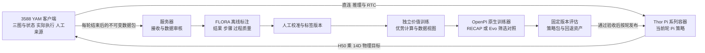

# 耳机入盒 RECAP 与 FLORA 适配方案

日期：2026-10-21。状态：研究提案，供用户审阅。

建议从现有耳机 Pi0.5 SFT 开始，建立“真机经验 → FLORA 辅助标注 → 价值学习 → 优势条件策略更新 → 固定版本评估”的闭环。首版采用 RECAP 的优势条件训练，参考 Evo-RL 的数据分层、人工纠正和按轮迭代；随后以 Evo-RL 最新论文的优势筛选作为独立对照。同时区分用户提出的两个方向：更细的指令跟随，与固定要求下的执行成功率。密集语义标注可以支持前者，也可通过阶段与关键状态监督辅助后者，收益需分别验证。

本次只形成方案与来源记录，没有创建训练配置、训练命令或作业，没有操作服务器、Thor、3588，也没有向客户端任务发送指令。原 EXPO-FT 设计保留为后续候选，尚未实施；本提案不代表已获准替换它或启动实验。

## 首个任务与成功条件

本项目耳机数据的原始任务是 `insert the wireless bluetooth earbuds into the charging case`，即蓝牙耳机入充电盒。首轮范围沿用这一任务，不扩大到外壳压装、关盖或电气充电检测。数据来源与三视图语义见 [数据合同](../../../04_data_contracts.md)。

建议将成功定义为：两只耳机均进入各自对应槽位，夹爪已经释放，撤离后仍保持正确就位，盒体和物料未掉落。稳定观察时长及可观察的入槽标准，须在标签试审时根据视频和实物确定。若三视图无法判明完全就位，则标记 `unknown` 并补人工确认，不把视觉接近槽位当作装配成功。

任务级结果为 `success / failure / unknown / cancelled`。达到预先约定的任务时间上限属于任务失败；断联、急停、相机失效及非任务原因中止属于取消。人工接管单独记录：有人纠正后完成属于辅助成功，不能计入自主成功率。

## 三个项目各自提供什么

| 来源 | 经核对的机制 | 本项目采用方式 |
|---|---|---|
| RECAP | 从示范、自主经验和纠正学习价值，计算优势，以好坏条件标签训练策略，部署时选择高优势条件 | 首版算法主线，更新 Pi 本身；价值和优势在服务器计算 |
| FLORA | Rewarder 提供结果、过程质量和自定义步骤评分；Captioner 提供动作语义标注 | 先做离线奖励与失败分析；阶段描述辅助定位问题 |
| Evo-RL | 按轮收集、训练价值和再更新策略；最新论文用成功轨迹的正优势片段筛选经验，并保留有效人工纠正 | 参考工程分层；优势筛选作为与 RECAP 分开的实验 |

RECAP 的算法依据是 [原始技术报告第 IV–V 节及附录 F](https://www.pi.website/download/pistar06.pdf)。Evo-RL 的 [最新论文](https://arxiv.org/html/2610.13345v1) 明确区别“优势条件”与“优势筛选”。其 [代码 README](https://github.com/MINT-SJTU/Evo-RL/blob/ec9842d8a8dd0371b4b50021547552e4608ec5ee/README.md) 仍包含 ACP 标签流程，不能把任意默认命令等同于论文全部实现。

### π0.6 复现的边界

π0.6 基座升级和 RECAP 后训练是两项工作。[官方模型卡](https://website.pi-asset.com/pi06star/PI06_model_card.pdf) 描述了 Gemma 3 4B 主干、约 860M 动作专家、448 像素图像与 Knowledge Insulation。本地现有 Pi0.5 使用另一套主干和原生参数树；加入奖励标签不会把它变成 π0.6。

因此本轮目标命名为 **YAM Pi0.5 的 RECAP 方法适配**。先证明耳机任务能从真实经验中提升，再单独评估 π0.6 的公开资产、主干迁移、预训练成本及 Thor 适配。保留可替换策略后端的边界，但不同时更换基座和算法，避免无法解释收益来源。

## 现有基础与需要补齐的部分

| 项目现状 | 对本方案的影响 |
|---|---|
| 耳机 clean-v2 原选集 1,384 集，约 50.03 小时；独立 val 17 集 | 有任务专属示范与 norm，无需从乐高模型起步；逐集任务成功仍需标签审核 |
| 10 月 19 日确认 source 15503、52311 两集应排除；独立剩余清单 1,382 集 | 使用前继续完成所需 QC，并明确新选集与 norm 合同；不能静默改成员后沿用旧 provenance |
| 文档保留耳机完整 34,000 步检查点的历史记录 | 先复核实际产物和真机能力，再选择基线；不从历史记录推定当前部署 |
| 原生 `train_lego_full.py --dataset` 已支持耳机全量训练 | 继续复用 OpenPI 训练循环、参数树及 JAX checkpoint |
| 普通 Pi 与训练式 RTC 已有路径 | 新策略沿用 H50、14D 输出和 RTC，保留 `rtc_mode` 关闭或回退能力 |
| 新 RL learner、奖励标注和优势数据入口尚未实现 | 这是新增适配工作，不能把现有看板、端口或历史 SFT 当作 RL 就绪 |

依据分别归 [训练状态](../../../03_training_and_evaluation.md)、[耳机数据](../../../04_data_contracts.md)、[Pantheon 排除审计](../../data-audit-pantheon-20261019/README.md) 和 [Thor 部署](../../../08_thor_edge_deployment.md)。这些是仓库证据，不是本次远端实时核验。

## 运行架构



服务器负责视频标注、价值学习、策略更新、实验比较和资产发布。Thor 只加载当前轮 Pi 策略、处理原有推理与 RTC；RECAP 首版不需要在每次推理中调用 Rewarder、价值模型、Edit 或多候选 Q。3588 仍拥有采集、控制仲裁、人工接管和实际动作记录。图中客户端部分只是接口需求，本轮不读取或改造其控制、相机或部署。

采集期间固定策略版本，一轮结束后再生成新模型。FLORA 和价值模型不进入机器人控制时延链路，训练服务器断连不影响现有本地推理。发布包绑定 checkpoint、norm、prompt 条件格式、动作合同、RTC 参数、代码版本、精度与延迟报告，并保留上一版本以便回退。

## FLORA 如何用于耳机标注

[Flora-Rewarder 模型卡](https://huggingface.co/nvidia/Flora-Rewarder/blob/7de68d22c4a9decec5ddb7f86ddcaee8f82d3367/README.md) 给出的模型规模为 27B：结果分数为 1–5；过程输出为每 0.5 秒一个 1–3 级动作质量标签；还支持按用户 rubric 评分。三路图像可按其多视图输入约定组织。采样、窗口、prompt 和输出解析应固定版本，具体格式以该版本官方示例为准。

建议分三层使用：

1. **终点结果候选。** 用整段上下文判断是否完成，再保留释放、撤离和稳定观察的原始证据。模型分数不是成功概率，也不能直接把 4 或 5 分无条件转成真值。
2. **耳机专属 rubric。** 分别检查左右耳机是否入对应槽、是否释放、撤离后是否稳定，以及是否存在掉落或明显错误。按耳机物料身份与槽位判断，不把左臂操作的耳机自动认成左耳机。
3. **过程诊断。** 标注抓取、姿态调整、对准、插入、释放、撤离以及重试；定位悬空、错槽、掉落、反复对准和弹出。阶段顺序允许双臂交错和回退，不强加单一路径。

首批建议试审约 200 条完整 episode，以成功、失败、接管及易误判情形分层覆盖。若这些类型不足，先补足可用视频，不把全是示范成功的数据伪装成奖励验证集。先划分开发集与封存的人工金标准，再用开发集调整 rubric；金标准按 session 隔离，不能在调 prompt 后反复当独立测试。

结果标签应分别统计成功精确率、失败召回率、unknown 比例和各失败类型误报；建议把“高置信自动成功标签精确率至少 95%”作为初期目标，同时报告样本量与置信区间。未达到则继续人审。模型自述置信度不作为概率，需基于人工集的实际错误率确定可自动接收的规则。

[FLORA 论文](https://research.nvidia.com/labs/gear/flora/assets/paper/flora.pdf?v=2026-10-19c) 报告的内部过程奖励 macro F1 为 46.2，不能据此认定耳机接触细节已可靠。首版训练奖励来自已审核终点结果；过程评分先服务诊断和样本抽查。后续若加入过程奖励，应作为独立消融，按真实时间区间聚合，不能把 0.5 秒标签重复到 30Hz 每帧后改变总奖励尺度。

完整视频可以用于事后结果标注；训练价值模型的输入只能使用当前时刻可获得的观测或过去历史。标注器看到的未来、最终结果文字和其解释不得进入当前观测，避免未来信息泄漏。

模型卡将 FLORA 限定于非商业研究开发。本方案按研究实验设计；未来若进入商业用途，应另行确定可用授权或替换奖励模型。27B 模型部署在独立服务器环境；BF16 参数本身约需 54GB，尚未计视觉、缓存和运行开销，不能假设单张 24GB 4090 可装载。优先评估可用的大显存卡或受支持的多卡推理，不以量化默认解决容量问题；不把 FLORA 的精度设置套到 Pi 部署验收。

## 指令跟随与执行成功分别研究

用户提出的两条主线适合作为实验划分：指令跟随考察模型是否遵守对象、顺序和动作约束；执行成功考察在明确要求下是否真的完成抓取、对准、入槽和释放。RECAP 的主要作用是后者。密集标注若用于训练细粒度的指令到动作映射，主要支持前者；若用作阶段、关键状态或关键帧的辅助监督，也可能改善后者。数据标注形式与模型收益不是一一对应，决定因素是训练目标及部署时的信息通路。

### 与后训练直接相关的工作

| 工作 | 如何使用额外信息 | 与本项目的关系 |
|---|---|---|
| [Steerable Policies 2026](https://arxiv.org/html/2602.13193v1) | 自动给示范加子任务、运动与像素指引等细粒度命令，在 OpenVLA 和 Pi0.5 上训练可引导策略 | 最贴近指令跟随方向；需要部署时可获得的命令生成方式，不能只在训练时给完美标签 |
| [StaKe 2026](https://arxiv.org/html/2606.26801v1) | 在 Pi0.5 微调中加入阶段分类与下一夹爪事件关键帧预测，和动作 loss 联合优化 | 证明密集结构监督也能提高固定任务成功率；可借鉴训练辅助任务，无需每步生成长文本 |
| [ECoT 2024 与 2025 修订](https://arxiv.org/html/2407.08693v3) | 由合成标注监督计划、子任务、运动和视觉定位，再生成动作；包含从发布 OpenVLA 检查点继续微调的实验 | 是让预训练 VLA 学习语义中间过程的后训练证据，但自回归推理和动作接口不同于当前 Pi |
| [ThinkAct 2025](https://arxiv.org/html/2507.16815v2) | 高层模型经过监督冷启动和强化微调，计划 latent 用于动作模型的任务适配 | 提供语义规划与 RL 结合的参考；不是直接给现有 Pi 多加文字的最小改造 |

StaKe 的双臂仿真均值由 52.4% 提高到 59.8%，为 **7.4 个百分点**，不是提高 14 个百分点；原文约 14% 指相对增益。这是其他任务的报告，不能移作耳机收益预测。其辅助头在推理时不调用，但两个 query token 仍保留；若采用该结构，仍需重新导出并验收 Thor 图和时延，不能声称模型输入与计算图完全不变。

这些工作支持“有用的结构标注能够改善后训练”，但不证明标注越密、文字越多越好。ECoT 还报告，额外混入通用视觉语言数据并未在其评测任务上产生可测的整体收益。应优先保留与动作决策相关的字段，而不是为每一帧生成冗长说明。

### 耳机任务如何使用语义标注

指令跟随分支可以研究“先装指定耳机”“另一臂等待”“暂停后继续”等**明确的新指令合同**。需有相应示范与在线可用的条件输入，并通过保持场景、改变指令的对照验证动作确实随要求改变。只训练同一条耳机入盒 prompt，无法证明模型获得更强的指令跟随。该分支改变任务约束，单独设计，不默认扩入首轮 RL。

固定任务成功率分支优先研究以下结构标签：各臂当前阶段、耳机身份与槽位关联、手中或槽内的可观察状态、释放与撤离事件、有效恢复片段。阶段允许并行、停留和回退；未知或遮挡使用不确定性 mask。视觉标签不能凭空提供毫米误差、接触力或电气充电事实，精细物理能力仍依赖原始图像、状态、动作与相应反馈。

最小实现研究可先在原生动作训练之外增加阶段与关键事件的辅助 loss，使共享表征学到任务结构，部署仍由 Pi 生成动作。另一条实现是让策略显式接收短子任务条件，部署时由仅使用当前及过去观测的模型预测；需用预测条件和错误条件评估，不能只汇报人工真值条件下的上界。两种方案分别验收，不先要求 Pi 每个 chunk 都自回归解码完整解释。

标注器可看完整视频来生成训练目标；输入策略的当前状态判断必须能从当前及过去观测得到。未来成功与下一关键帧可以作为预测目标，不能作为在线已知输入。描述错误动作的 caption 也不是正确指令，例如“松爪导致掉落”不能直接变成应当模仿的“松爪”。恢复目标应来自有效示范或经审核纠正，不能由事后解释补造不存在的正确动作。

### 将收益分开验证

在固定耳机任务上，建议将“语义辅助监督”和“RECAP 优势条件”做成两个实验因素：原生动作后训练、加语义辅助、加 RECAP、两者结合。各组固定同一原始数据来源、初始化、评估场景与计算预算，并记录算法造成的实际样本/标签差异；错误失败动作不当作正向示范。先分别比较语义监督和优势条件的增益，再决定是否结合，避免把更长训练或更多纠正数据算作标注收益。

指令跟随另设指标：给定可行且明确的约束后，对象、顺序、等待或暂停是否正确；执行成功率则以完整物理任务结果评价。除了总体成功率，还需区分“遵守了要求但插入失败”和“完成了插入却违反指定顺序”。若目标是提升当前固定耳机任务，应优先 RECAP 与结构辅助监督；细粒度开放指令作为独立后续方向。

## RECAP 学习设计

### 把结果变成价值与优势

Rewarder 负责“这次做得怎样”，价值模型负责“从当前状态继续完成还要付出多少代价”。两者分别验收；不能把 FLORA 分数的上升直接当成策略优势。

首版建议采用 RECAP 的结果与时间成本思路，并以秒而非帧计量，作为明确的 YAM 适配：非终点转移奖励为 `−实际经过秒数`；成功终点奖励为 0；真实任务失败增加固定惩罚。失败代价须大于任务时间上限，使快速失败不能优于最慢的合法成功。按预先确定的任务上限与失败代价固定归一化尺度，奖励和价值使用同一单位；换采样频率不改变优化目标。unknown、取消和不完整回放不构造虚假终点回报。

独立价值模型预测此任务的剩余回报。首选评估 Evo-RL 已提供的 SigLIP 加分布价值头和原生 value trainer；三视图按固定语义接入，状态或短历史是否加入作为独立模型版本。若单帧无法区分夹持与释放后就位，应补可观察历史，再检验误差，不强迫单帧给出确定价值。

固定审读代码中，`time` 和 `time_takeover` 的目标构建器要求全部 episode 明确成功，**不能直接接入本方案的成功与失败混合池**。须选择并核对其 legacy 路线，或为原生 value trainer 增加与本奖励一致的目标 hook；保持训练器复用，不复制训练循环。见 [奖励目标构建代码](https://github.com/MINT-SJTU/Evo-RL/blob/ec9842d8a8dd0371b4b50021547552e4608ec5ee/src/lerobot/values/rewards.py)。

对有效窗口计算：

```text
A_t = 窗口内累计奖励 + V(窗口结束观测) - V(窗口开始观测)
I_t = 1[A_t 超过该任务该轮冻结的阈值]
```

到真实终点时使用终点边界，不额外加一次终点价值；不能跨 episode、epoch、取消或缺帧拼接。窗口长度与 H50 是不同概念：原文后训练采用 50 步前瞻，但本项目必须依据 30Hz 数据和实际 RTC 执行跨度明确秒数、有效长度及边界，不能从字段同为 50 推定相同语义。

例如未归一化价值从 −5 秒改善到 −3.8 秒，窗口耗时 0.5 秒，则优势为 `−0.5−3.8+5=0.7`；若只改善到 −4.8 秒，优势为 −0.3。这说明接近完成但不断犹豫的动作仍可能低优势。阈值在训练数据上确定并随该轮价值版本冻结；用留出的 session 或按 episode 交叉拟合检查标签稳定性，不能凭训练拟合误差宣称优势准确。

### 把优势吸收到 Pi 策略

沿用 `pi05_yam`、`LeRobotYamDataConfig`、`YamInputs/YamOutputs` 和 OpenPI 原生 flow-matching loss。训练输入增加高低优势条件，并保留一定比例的不带条件样本；部署默认高优势条件。失败经验可训练低优势分支，不能因为保留了失败轨迹就把它当作正向示范。

首版研究以固定文本条件表达优势，复用现有词表与 tokenizer，而不新增词嵌入；具体格式同时绑定数据视图和端侧策略包。必须静态检查 prompt 清洗、state 串长度和 token 截断，确保条件确实进入训练和推理。正式实现还要核对训练与导出的 attention mask、prefix 缓存以及 TRT 输入是否一致。

经审核的有效人工纠正可作为正向样本；原始 `is_intervention` 只说明动作来源，并不证明纠正有效。人工纠正后的成功不能把之前的自主错误全部改为高优势。接管前后按来源边界构造动作块，短片段使用有效长度和 loss mask 或明确不采样，不能填充重复动作后照常监督。

Pi 继续使用全量微调路线，不自动改成 LoRA，也不替换现有 JAX checkpoint。具体可训练参数、学习率、步数、数据比例、条件 dropout、优势阈值及窗口长度在获得本轮数据统计后形成完整配方，再按项目规则确认。首版直接采样高优势条件，不引入需要额外推理的 CFG。

### Evo-RL 筛选作为独立对照

共用数据接收、标签来源及价值结果的可比部分，另建筛选视图：保留原始示范，保留成功干预轨迹中连续的人控纠正片段，加入成功自主轨迹中的正优势片段，并提高高优势示范片段的采样权重。它不需要给策略加入优势文本。

如复现论文的成功轨迹价值目标及接管惩罚，则使用独立奖励与价值版本。接管惩罚归于进入人控前的自主转移，不惩罚之后的人类恢复。不要把同一轮“RECAP 混合失败价值”与“Evo 成功轨迹价值”的不同结果混用成同一个 baseline。

推荐顺序为 RECAP 先验证、Evo 筛选随后比较。这样先回答用户提出的优势条件路线能否提升，再判断耳机任务是否更适合只学习精选片段。原 EXPO-FT 的在线 Edit/Q 不进入首轮，待收益和瓶颈明确后再评估。

## 数据与 RTC 的项目适配

底层数据保持双臂 14D `[左6关节, 左夹爪, 右6关节, 右夹爪]`，三图键为 `observation.images.top_rgb/left_rgb/right_rgb`，状态为 `observation.state`，动作为单数 `action`。具体物理单位继续由 metadata 与 audit 证明。raw 保存实际执行的物理目标；Pi 训练仍按 `(6,-1,6,-1)` 将关节变为相对观测 state 的 delta，夹爪 absolute，内部 32D 与 H50 由原模型拥有。

新增信息保存在不可变 sidecar 和新训练视图：

| 信息组 | 内容与用途 |
|---|---|
| 来源身份 | task、source revision、source episode、run/session、文件哈希；划分与排除可追踪 |
| 行为身份 | Pi/norm/engine/prompt 合同、RTC 模式、行为 bundle、源码；每轮固定 |
| 执行时间轴 | 观测和 request ID、模型动作下标、真实提交 tick、epoch、承诺前缀、delay、实际执行值 |
| 人工来源 | 逐 tick 的 policy/human/HOLD 来源、接管起止和恢复；未知不伪装成自主 |
| 结果证据 | success/failure/unknown/cancelled、终止原因、稳定观察区间、人工裁决和证据帧 |
| 派生标签 | FLORA revision、prompt/解析版本、原始输出、审核结果、reward/value/advantage/indicator 版本 |

raw 不覆盖。FLORA 标注和价值推断均写新目录；Evo-RL 示例中的原地回写数据集不适用于本仓库。示范、自主和纠正分池，奖励金标准和策略评估按 session 隔离；不能把同一 episode 的相邻片段拆到训练和验证两侧。

RTC 中价值样本必须对应真实发生的状态转移。策略未执行的 H50 后缀只能留作候选日志，不能成为有真实奖励的执行动作。学习样本以同一观测时刻重建实际动作块；已承诺前缀保留，训练 loss 只覆盖合同允许的有效动作，`delay / commitment / source mask / padding mask` 分开。取自旧观测的动作先按旧 state 解为物理目标，再按训练样本 state 重编码，不直接跨观测相减。

旧示范缺少 RTC/request/接管历史时，仍可进入经审核的示范池，不能捏造这些字段后称在线经验。使用新数据成员或新 norm 时，要显式解决当前入口的成员一致性检查；保持原 norm 的实验需要专门的继承合同，不能手改 provenance 绕过检查。

## 仓库实现边界

以下路径均为拟建模块，本轮不创建可执行入口：

| 位置 | 负责的最小改造 |
|---|---|
| `packages/vla-platform/src/vla_platform/` | 标准库身份、schema、数据包接收审核、版本与状态管理；不导入 Torch/JAX |
| `adapters/flora/` | 薄调用固定 revision 的官方推理、采样与输出解析，独立模型环境 |
| `adapters/evo_rl/` | 固定上游原生 value trainer/infer，YAM 数据与奖励 hook；输出新 sidecar |
| `src/openpi/training/` 及原生数据 transform | 读标签、优势条件或筛选视图、来源与有效长度 mask；继续使用现有训练循环 |
| `scripts/train_lego_full.py` | 接入明确的 RL 数据合同与原生配置，保留现有耳机/Lego SFT 行为 |
| `scripts/thor/` | 训练与推理一致的条件输入、策略包验证、既有普通/RTC路径和回退 |
| `docs/11_training_dashboard.md` 对应遥测 | 标注吞吐与人审率、价值验证、优势标签分布、真机成功/接管/时长和版本 |

Pi 策略与 RL 适配使用独立的 Pi-RL Conda prefix；FLORA 和 Evo value 后端按其依赖单独隔离，控制层通过子进程调用。不把 Evo 的 LeRobot fork 整体替换本项目 OpenPI，不导入 SO101/Piper 硬件控制，也不改在用服务器环境。

客户端所需字段应先对照既有录制产物确认是否缺失，随后形成具体、可审阅的差异清单。只有用户审核后才能给客户端任务发送实施指令。当前无需为研究方案触碰 3588。

## 分阶段实验与晋升标准

以下数量为采集和审阅预算建议，不是训练配方或已批准的真机操作。

| 阶段 | 建议工作 | 进入下一阶段的条件 |
|---|---|---|
| 0 基线与标签 | 复核耳机检查点/norm/数据；约 200 条视频试审；在固定场景下规划 50–100 次基线评估 | 成功语义明确，金标准封存，数据来源及排除可核验 |
| 1 数据闭环 | 审核录制与实际动作；补失败、成功恢复、错槽、释放弹出等经验 | 时间轴/来源完整，异常与取消分离；客户端差异已获审核 |
| 2 首轮更新 | 建议每轮预留 100–200 个有效完整尝试的采集预算；先展示完整配方再生成配置/作业 | 价值和优势在独立数据上有效，原生保存恢复及动作变换通过验收 |
| 3 Thor 验收 | 同输入数值核对，真实本地推理及获准的跨 IPC smoke | 精度、条件、RTC 承诺前缀和延迟满足部署合同 |
| 4 固定比较 | 先比较 SFT、同预算人工纠正、RECAP，再追加 Evo 筛选 | 按相同初始化/任务分布/时间上限和训练预算解释差异 |
| 5 继续或调整 | 固定新版本采下一轮；定位仍失败的阶段 | 有稳定收益则迭代，否则回到标签、价值或示范覆盖补缺 |

若基线几乎不能到达入槽阶段，应优先补任务纠正和恢复覆盖；若已接近饱和，则转向更难初始化和时间效率。不能预先承诺达到某个成功率或在固定小时内收敛。

策略晋升以**全任务无人工接管成功率**为主指标，附成功次数/总数和 95% 置信区间。另报辅助成功率、接管次数/分钟、任务完成时长 P50/P90、错槽/掉落/弹出率，以及含失败、复位、接管和停止时间的每小时完整成功数；保留原始计时口径，不能只挑成功样本算吞吐。

建议先用 50–100 次每策略的分层试验筛选。小幅改善若区间重叠较大，应增加独立 session 与样本再判断，不能用几次演示宣布晋升。按相同初始化分布随机交错评估，控制盒体、耳机、光照、相机和操作者影响；封存的挑战场景不参与 rubric、阈值或检查点选择。候选需提高自主完成能力，且关键错误、接管依赖、动作连续性与时延无实质退化，才进入后续发布评估。

本地仅做 schema、标签解析、动作变换、mask、版本绑定和可视化等静态或轻量测试。所有训练循环及训练 smoke 留在获准服务器资源上，长训练使用 Slurm/tmux；每轮先展示数据、标签版本、初始化、norm、训练参数、预算与停止条件，取得所需确认后才生成配置、命令或作业。

## 近期建议

先完成耳机任务的结果标准、FLORA 金标准试审与现有录制字段差距分析，并将结果分数和可用的语义字段分别评估。这些工作能判断奖励是否可信、哪些标注适合结构监督，以及下一轮到底缺数据还是缺模型适配。首轮以固定任务成功率为主，指令跟随单独评价，之后再提出具体训练配方。

外部来源与固定版本见 [sources.json](sources.json)。架构入口见 [01 系统架构](../../../01_system_architecture.md)；训练、数据、协议和部署事实仍分别由 03、04、05、08 持有。
