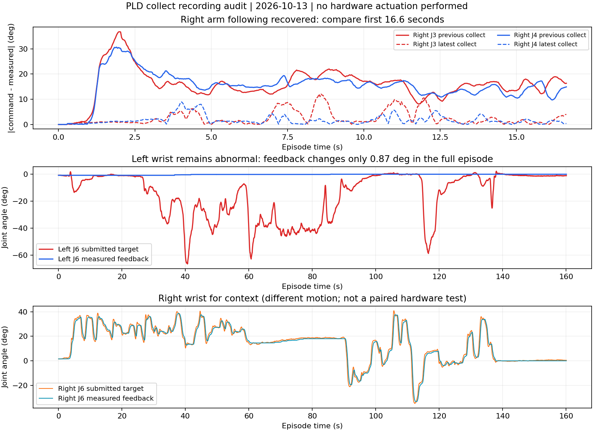

# 真实 collect 执行与时序核查（2026-10-13）

**最新跨IPC核查已通过：** 优化后的episode_000003（4316行）使用collect＋前缀10，409有效回复/0迟到，左右臂均执行真实修正，47/50在线窗口可继续奖励审核。可以按当前版本批量采20集，成功/失败都保留。最后一个窗口尚未完成就停录、另2个关联待复核，均暂不入库；每集拍到当前动作结束与最终现场后再停。用户确认原10/10误填，按起始10块、末尾1块蓝色未完成，派生结果已更正9/10；原始事件保留，C/N仍只评估。[最新完整审核](e05-fast-d10/README.md)。

## 当前结论：10步前缀试采通过，可采20集

最新为同一session `session_20261013_122649_fbc88d/episode_000002`，UUID `208c1c6d539648bea68188f880d2b0cd`，3085行/102.829秒，collect、前缀10步，0人工/0无效观测。左右臂已恢复跟随，没有重现前两集持续冻结；左J6典型绝对跟随误差0.02055rad。实际非零修正1260tick（左498/右762），归一化SDK输入与所选原生动作来源一致。最新整轮人工事件C=9,N=10，仍只作评估。

293个回复中292接受，0迟到，最后1包因录制结束取消；248个专家区间全部通过执行来源核验。在线38窗口（左14/右24），其中37个可继续奖励审核，1个无法唯一关联物理闭合暂不入库。39个物理闭合候选中38个有合格抬升画面；抬升不等于成功，尚未发布抓取1/0或训练。

前一集同session的episode_000001为2478行/82.583秒、前缀9步，左右跟随已恢复，但236回复中13个晚1tick，22窗口有10个因执行链缺口被排除。改10步后本集没有迟到，支持按此配置受控采20集，不承诺未来永不迟到。每集固定actor/合同/模型并保留C/N，失败和正常成功均记录；设备故障仍单独隔离。

[e03九步核查](e03-d9/summary.json)、[e04十步核查](e04-d10/summary.json)绑定原始数据。两集副本分别在`/home/wuyan-lyj/condapi-data/rl/lego-pld-collect-20261013-e03-v1/`和`lego-pld-collect-20261013-e04-d10-v1/`；e04只复制本次episode_000002及完整session侧车，不修改原session其他episode。11文件/247,674,438字节，复制前后及本地哈希一致。

用户随后明确“现场已暂停，现在验收升级”，授权同一checkpoint/actor的推理性能升级。优化源码`22fcebf`，部署结果与客户端改造建议另见[延迟优化报告](../../thor/pld-latency-20261013/README.md)。下面两集故障记录保留为历史，不再作为当前硬件未修复的结论。

## 前两集故障核查（历史）

最新一集恢复了抓取、抬升和放置，右臂第3/4关节不再呈现上一集持续严重偏离目标的现象。但左臂第6关节反馈几乎不变，用户已确认没有有意锁定，需要现场/客户端核对。此轮只读复制原录制、做CPU数据分析和视频抽帧，没有操作机械臂、改动Thor服务、发布奖励或训练。先保留诊断，不将设备异常自动标成策略失败，也不把8/10归因于RL学习改善。

## 数据身份与完整性

两集都属于“乐高分拣-pld-rl-第一轮collect”，但在不同session中，文件名均为episode_000001。本文“上一集/最新集”按session区分，不能单看episode编号。

| 项目 | 上一集 | 最新集 |
|---|---|---|
| session | session_20261013_094101_faa55f | session_20261013_112049_7607a7 |
| UUID | dcdf885719174340a79be34897e0d7d5 | ebc30e7105454c6099a395d618b9cf0d |
| 原始行数 | 500 | 4800 |
| 内部时钟跨度 | 16.633秒 | 160.074秒 |
| 模式 | collect | collect |
| 人工介入行 | 0 | 0 |

两集同一合同`87b1affa6d81e1d0cf6299bf6e827bd260361104338708e67579c874ee65d7ec`、同一actor快照`583ae73a422912ea6e5e0e495127d40d5b6d5dbc6ad6ec8af0dac7f322d31144`。它仍是0次梯度更新的初始化探索包。最新集15文件/317,475,665字节，只读复制前后源SHA一致，本地文件一致。4800行跨3段，三视角共9个视频；本轮抽取总览及候选证据，不冒称逐帧视觉判奖。

## 右臂改善的证据与边界

对两集前500行、各491个policy有效下发样本计算同tick目标与实测的绝对差中位数：右J3由0.27873降为0.02212 rad（15.97°→1.27°），右J4由0.26970降为0.02167 rad（15.45°→1.24°）。这是执行跟随指标，不是任务成功率；动态动作下有正常时滞，不能把每个瞬时误差解释为硬件故障。

上一集第一笔实际非零修正发生在2.10秒；此前右J3/J4已显著偏离目标。最新集视频抽查可见抓起、运输和入框，没有重现上一集右爪全程顶桌的状态。两集初始关节均接近零位，右夹爪初始开度不同；并非相同场景/动作的严格因果对照。证据支持此前存在执行异常，不能据此确诊电机损坏，也不能断言所有问题均由机械硬件造成。

## 左腕仍须排查

最新集左J6实测范围只有[-0.014687,0.000572]rad，全程跨度0.015259rad（0.87°）；目标范围[-1.162046,0.038720]rad。97.62%的相邻样本实测值完全相同。约31.81–56.10秒、59.46–83.83秒连续偏差超过0.3rad。

40.631秒（row1218）实测-0.007439rad，目标-1.162046rad，误差1.154607rad（66.15°）。该时刻Pi物理基线本身就是-1.162046rad，直接RL增量为0；测量state和输入Pi的observation.state均为-0.007439rad。四路聚合SDK更新时间很近，不代表每一电机反馈都新鲜。没有关节级CAN实际写入、使能、故障码或反馈时间戳，policy_write_trace为空，不能区分未使能、指令映射/下发、机械阻力与陈旧反馈。用户确认没有有意锁定，不自动把这一维视为合法固定关节。

下一步现场/客户端应对照左J6目标、电机ID映射、实际发送目标、使能/故障状态及该电机反馈时间戳；先在无自主推理、由操作者保证安全的条件下检查。这里只提供排查方向，没有向客户端任务发送指令，也没有读取或修改3588控制/相机/系统文件。

## 修正、整轮结果与入库

- 最新集实际非零修正1494个控制tick：左552、右942；SDK下发与原生token所选physical_actions无不明差异，来源缺失0。它证明归一化SDK输入一致，不证明每个电机实际执行到位。
- 最大单关节直接增量0.01163rad（0.67°），夹爪0.0270；同姿态FK计算的直接命令差最大7.19mm。这不是物理碰撞保证，也不是闭环总影响上界。
- 在线40个窗口（左12/右28）；43个相对闭合候选＋1个未闭合窗口补充，共44个待审核候选，其中29个有合格抬升画面。窗口、候选、真实成功次数不等价。
- 客户端evaluation事件记录C=8、N=10，即本轮人工记录分拣进度80%；不是抓取成功率或策略平均成功率，按既定合同不参与本阶段SAC更新。
- 456个回复，432接受、23个迟到1tick、1个在结束时取消。服务端P95 223.02ms，worker P95 263.52ms；9tick延迟下大部分回复无富余tick。
- 重建310个区间，267通过执行来源检查、43拒绝；40窗口中15个含拒绝区间、1个无法唯一关联闭合、24个仅等待结果审核（右16/左8）。这24个尚未通过本次新增的关节健康审查，不能直接称可训练样本。
- 5行观测无效保留；缺来源的拒绝目前以`'epoch'`呈现，后续应改进诊断信息，不补造来源。未发布任何1/0标签，replay未就绪，未启动训练。

当前保留原件和全部候选。先核查左腕，再决定哪些段可作为正常动力学的训练经验；右臂候选也需考虑同场左臂状态和迟到缺口，不能仅凭左右划分直接入库。原首集设备异常不当作健康策略验证集，后续split需明确，不在这次审核中悄悄重划。

## 证据路径

[最新集摘要](latest-summary.json)、[左腕逐项核查](following-check.json)、[持续偏差区间](left-wrist-check.json)、[入库统计](ingestion-summary.json)。完整原始15文件、散列、两集比较脚本、FK/修正逐tick表、44候选证据及画图源数据在：

`/home/wuyan-lyj/condapi-data/rl/lego-pld-collect-20261013-e02-v1/`

上一集不可变副本仍在`/home/wuyan-lyj/condapi-data/rl/lego-pld-collect-20261013-e01-v1/`。本报告分析代码及产物位于上述本地目录；本轮未另行宣称服务器归档或训练完成。
