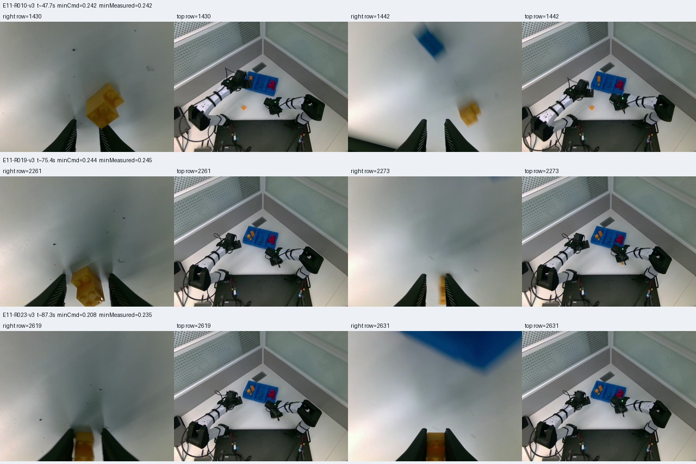
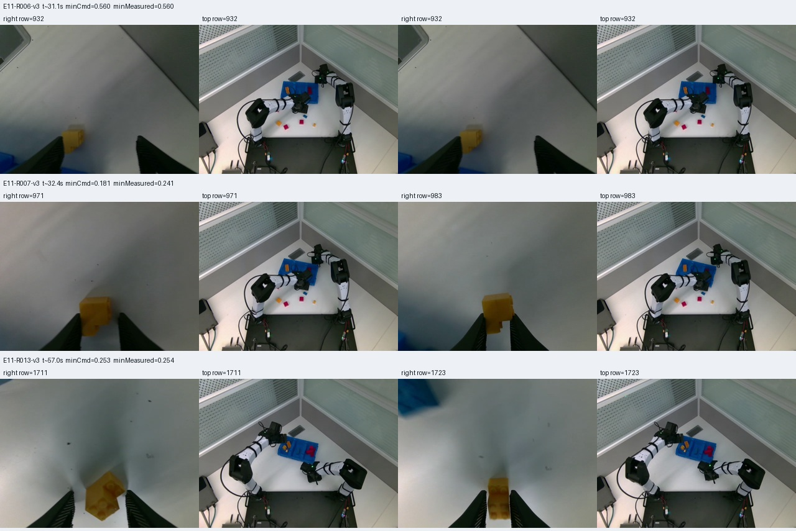

# Actor-2：第11集eval实录核查

用户2026-10-14反馈高度补偿已可见、夹爪仍多次闭合不足，要求只读核查；未修改线上配置，未占用Thor GPU或停止推理。来源为第二轮同session的episode_000011，UUID `6fa76e1f2c2046dc995e35d478929417`，快照f668170b…、eval/前缀10。新目录保留源文件，9个episode成员复制前后SHA一致，完整session事件前缀582,697,689 bytes冻结并核对；6视频全部解码/索引通过。

## 执行链和整轮结果

2808行、93.566秒、264个接受回复，无HIL、无无效观测、无来源缺失或下发差异。26个实际被消费的专家窗口（左7/右19）；1101个非零修正tick（左354/右747）。现场server P50/P95=216.64/219.99ms。至此有新actor真实跨IPC执行证据，但不代表成功率提升已被A/B证明。[录制审核](eval-e11-recording.json)、[逐臂与窗口细节](eval-e11-corrections.json)。

操作员记录C/N=10/10，末帧桌面清空；颜色/对象计数标签仍明确归操作员来源。relative_v3检测30次实际收拢，27次位于专家抓取空间；另外R006/R007/R013的腕部＋主视角证明也在尝试抓黄色积木，计入整任务后总A=30（左7/右23），不能因专家不介入就从效率分母删除。三次补计只影响计数，不伪造抓取成功或RL奖励。此前collect唯一10/10为43次，两者不是相同初态随机化对照，不能据30<43宣称actor提升。

## 高度修正已实际下发，夹爪幅度较小

统计1101个非零修正tick，目标FK为已选择的修正后目标减去同一回复的Pi基线：

| 项目 | 中位数 | P95 | 最大 |
|---|---|---|---|
| 绝对高度差 | 1.51mm | 8.42mm | 向下20.96mm（向上最大11.55mm） |
| 三维目标FK距离 | 3.43mm | 14.66mm | 35.87mm |
| 绝对夹爪开度修正 | 0.00293 | 0.01360 | 额外闭合0.03445（额外张开最大0.02072） |

开度0闭/1开，负修正才是额外闭合。这些是实际消费命令的反事实目标差，不是“如果没RL，机械臂真实位置会差多少”的实验结论。典型夹爪修正约全归一化行程0.29%，P95约1.36%；没有触及客户端0.02下限，原回复与SDK提交一致。本集不能把现象归因于客户端限幅。

## 闭合阶段的控制窗口缺口

155个处于correcting阶段的请求中，85个无需几何缩小、20个经几何缩小、49个被`insufficient_grasp_only_horizon`返回Pi、1个因基线桥接运动约束返回Pi；49个中47个已经确认相对闭合。它们不是actor恰好输出0，而是解码器先判定没有足够的抓取专属轨迹长度。

实现位置：`planning_context()`在预测抬升达到5cm或重新张开前截断可编辑尾段；当前不足9步（0.3秒）就全部关闭修正。RTC前缀10步另不可改。因此在Pi即将抬起时，夹爪可能仍未闭好，但专家已失去剩余闭合段的控制权。此限制本意是避免进入运输/放置，当前把闭合与关节连续过渡绑定在一起，留下了控制缺口。

- R003：参考低点row568，Pi开度0.28831→修正0.28689、向下7.19mm；row574及最小闭合row579均因短窗口返回Pi，最低命令0.24265、实测0.24374，抽帧显示空手。
- R010：row1430，Pi 0.292998→0.291843、向下5.22mm；row1436及最低命令row1445均因短窗口无修正；最低命令0.24181、实测0.24239，画面中黄色块未稳定夹在两指之间。
- R019：row2261，Pi 0.38050→0.38334（微微张开）、向下3.23mm；row2267开始短窗口，末端最低命令0.24376、实测0.24461，画面中积木偏在一侧。闭合与对准问题可能同时存在。
- R023：后续黄色块抓住的示例，最低命令0.20844、实测0.23504。不能因有物体使实测开度高于命令就诊断硬件不跟随。

## 下一步建议（尚未修改线上）

先解决临闭合时控制窗口不足：把关节平滑修正所需的过渡长度和夹爪闭合/持物资格分开验证；临近退出时允许短而有界的闭合修正、记录实际尾段，再在抓起持住后交还Pi。必须保持前缀、可逆切换、放置禁介入，不把5cm高度直接当作成功。

另单独设计夹爪collect范围。当前全范围±0.05，actor实际通常仅几千分之一；若Pi只发0.24，当前上限也无法探索至0.05附近（需要约-0.19）。因此需要按实际夹爪物理响应与夹住不同尺寸物体的录像确定新范围和闭合持续时间；新合同先离线/协议验收，再通过真实collect与奖励训练，不能直接倍增现有eval或强制所有积木闭到0.02。现有成功失败数据继续保留；本集先作评估，不擅自混入训练。

本地全证据：`/home/wuyan-lyj/condapi-data/rl/lego-pld-actor2-eval-e11-20261014-v1`。CPU分析脚本、命令CSV、全session审计前缀、视频和原始/派生哈希一起保留；本页计数复核由助手查看固定帧完成，不使用新VLM标签冒充人工真值。
