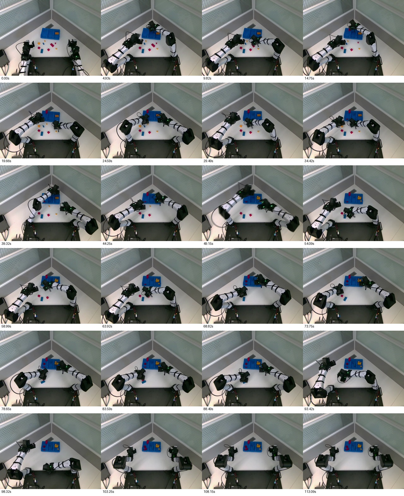

# 连续探索首集审核与采集预算

2026-10-14，只读审核“乐高分拣pld-rl第二轮”的最新已完成录像：session `session_20261014_110716_0aa69a` / `episode_000001`，UUID `d57d0541a3814a71a6e9028c8e7682c2`。快照 `7013be46…`、collect、前缀10。用户反馈跳变减小；本次不修改在线服务、不执行训练或发布奖励。

## 审核结果

- 3,393行、113.09秒，9个原生成员复制前后及本地SHA一致；6个分段视频完整解码并核验索引。无人工介入、无无效观测。原件另保留在IPC，本地新目录不覆盖任何旧批次。
- 321个接受回复，停录附近1个丢弃回复保留并隔离。0实际提交差异、0动作来源丢失；服务推理P50/P95=215.86/217.78ms，客户端worker P95=261.42ms，两个时钟指标不混为同一延迟。
- 29个闭合在线修正窗口（左10、右19）、219个合法决策区间，全部在线窗口均有实际非零修正。直接来源可证明的修正tick共1,367（左679/右688），不是1,367次独立抓取。
- 219条active trace的采样来源和连续轨迹解码重算通过。可用连续桥接的首个可编辑目标步，其速度与前缀末端速度一致，检查最大差0；这只是该接缝指标，不代表整段加速度为零或实机抖动完全消失。
- 实际下发相对该请求Pi参考的最大关节差0.07152rad、最大目标FK差51.30mm。非零tick的目标FK差P95左23.39mm/右28.44mm，最大左41.20mm/右51.30mm。没有缩回到原先仅几毫米的探索。前缀包含已提交的修正，不能把新请求相对Pi参考的差简单当作整条反事实纯Pi运动。
- 已下发非零修正目标均在当前抓取FK范围，未发现越过当前容器边界。顶视整集时间采样及部分抓取序列目视检查未发现明确放置越权；这仍是本场景运动学约束加抽查，不是通用视觉阶段识别验收。

[执行与视频核验](execution-audit.json)、[轨迹与范围](continuity-audit.json)、[奖励资格](reward-readiness.json)、[复制回执](copy-receipt.json)。原始完整事件与视频在 `/home/wuyan-lyj/condapi-data/rl/pld-continuous-first-20261014-v1/`；Thor独立备份在 `rl-training/datasets/continuous-first-20261014-v1/`。

## 奖励还不能按29个窗口全发

离线相对切段找到36个收拢候选（左12、右24），不等于36次独立抓取。29个在线窗口中24个能唯一关联闭爪并生成结果证据（左9、右15），其余5个窗口含两个收拢候选。已抽看其中右臂首窗与左臂相应重复收拢序列；可能是同次接近中的重新调整，不能未经核对把同一结果发给两段。先保留并离线整理，当前不强制重复发奖。

24个有结果证据的候选中，16个已具备末端新鲜、多帧、抬升资格，可交现有Qwen＋DINO判持物/空手；这是视觉输入资格，不是16次成功。其他存在未抬升、重新张开、核验末帧高度不合格等情况，按原结果合同分别审核，不将缺证据自动当失败。当前发布奖励为0、训练更新为0；本次只确认可继续采集，不宣称actor已提升成功率。

## 下一批预算

建议保持当前镜像、actor、0.08上限和前缀10，先再录9集，凑10个新版episode后做一次冻结判奖与训练准备。工程目标为至少150个有实际修正且结果可核验的局部尝试、左右各至少50个；保留自然发生的成功和失败，不人为制造失败、不只留整轮成功。

若10集后因重复收拢、遮挡、未抬升或左右失衡未达到可用量，再补5集到15集。150/50是根据本集产出给出的下一次更新预算，不是已验证的样本复杂度或保证收敛。旧13集保留，新旧解码坐标须按合同适配后才能混用。当前候选提取的默认split不是最终训练划分；正式训练前按episode固定验证，并在新训练视图写出，不覆盖原件。

