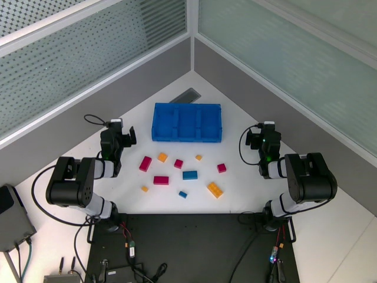
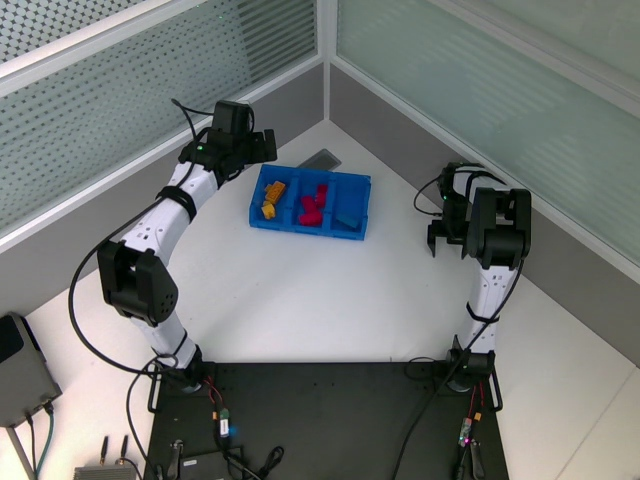
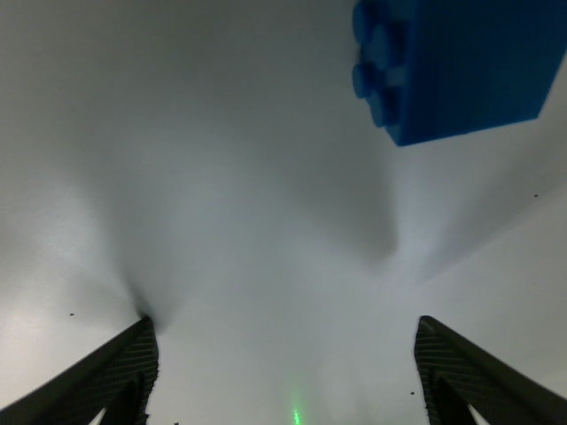

# 优化服务后的跨IPC真实录制核查

结论：本集支持按当前collect＋前缀10批量采集20集；保留成功、失败与异常记录，当前未训练或发布抓取奖励。系统执行和时序通过，47/50在线窗口可以进入结果审核，不能把47写成成功次数。收尾需等本次动作结束并拍到最终现场再停录。

- 最新session_20261013_122649_fbc88d/episode_000003，UUID b05fdb3e4ef1449a89a0fd607819184e。4316行/143.935秒，collect、前缀10、0人工、0无效观测。15个原始成员/374,435,093字节，复制前后与本地散列一致；只读原始数据，没有访问/修改3588控制或部署。
- 全部410回复包含优化后的base_infer_ms/pld_postprocess_ms/request_decode_ms，运行服务实际为pld-rl:thor-latency-20261013-r1、healthy/MAXN。409回复接受，0迟到，最后1包在停录时取消。大部分回复有1个控制tick余量；4包余量0，但均按原RTC时间轴接受，不能因此保证未来永不迟到。
- 现场服务端P50/P95=212.90/214.23ms；活动PLD后处理P50/P95=10.52/11.30ms，Pi约202.49/203.26ms。客户端worker P50/P95=248.63/257.91ms，最大299.72ms。观测tick到主循环处理P50/P95=299.99/300.51ms，P99=330.67ms；它包含对齐及控制周期量化，不能与纯服务时间混用。客户端进程/传输剩余开销仍在，[分项证据](latency.json)。
- 左右臂均完成过抓取、抬升和放置；左J6反馈不再冻结（典型误差0.01846rad），右J3/J4典型误差约0.02490/0.02485rad。记录内device_tracking_fault均为空。右J4在启动和末尾抓取仍有较大动态偏差，末尾142.07–143.94秒超过0.3rad且反馈持续移动；目标与实测/接触影响仍需结合画面解释，不确诊为电机故障或声称整集运动完全无误。[针对性核查](focused-review.json)。
- 1762个tick实际执行非零探索（左594/右1168），最大单关节0.01191rad、夹爪0.03579；4306个policy行与原生token所选physical_actions一致，来源缺失0。只是归一化SDK输入的来源一致，不证明每个电机都执行到位。
- 50个在线窗口（左15/右35），44由lift_guard结束、5重新张开结束、最后1个未完成；344个区间中342通过，2个因停录取消边界被拒绝。47窗口可继续判奖；w7/w12在门控窗口内找不到唯一物理闭合，需复核仲裁/闭合起点；w50停录时未完成并含两次物理收拢，整窗暂不入库，不连补缺口。
- 54个物理收拢候选，49个有合格抬升画面；三个视角9视频全解码共12,948帧，PTS递增、视频索引均在范围内。这里只做执行与证据资格审核，没有逐条发布held/empty标签。

## 收尾与整轮结果

用户已确认原`10/10`误填，要求按录像末尾复核。起始10块（红4、黄4、蓝2），末尾1块蓝色仍在桌面、未完成入框；派生整轮结果更正为**C=9,N=10，即90%完成进度**。[复核记录](end-state-audit.json)保留原10/10事件、用户纠正、画面引用及原始侧车SHA。原始事件发生在最后录制行16.19秒后，仍原样保留，没有回写或删除。

最后窗口约139.8秒开始，停录时动作尚未完整结束，不能按抓取成功发奖，整窗继续暂不入库。本阶段全局C/N只作评估，不进入SAC；前面47个合格窗口仍保留，少数窗口排除不阻断批量采集。该90%是本集录像末尾的完成进度，不是策略平均成功率或自动奖励器准确率。

原始15成员、完整侧车、54候选图像/蒙太奇、50窗口进入图、逐tick修正和可复现分析脚本保留在`/home/wuyan-lyj/condapi-data/rl/lego-pld-collect-20261013-e05-fast-d10-v1/`。本轮没有改服务、客户端、权重、actor或奖励合同；没有训练。
