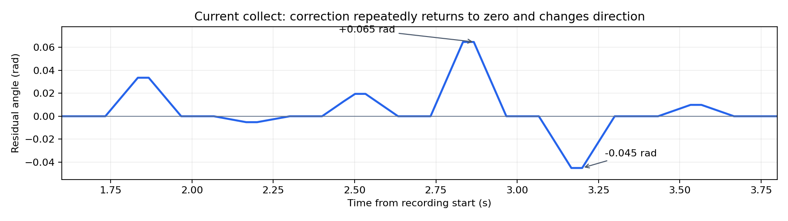

# 0.08 collect首集：叠加正确，但探索时间结构产生短脉冲

2026-10-14用户反馈动作莫名跳动。只读核查任务“乐高分拣pld-rl第二轮”、session `session_20261014_094616_aed76c`、`episode_000002`，UUID `4ad07fa47cfd4b1e901979a141683264`。最新有效录像372行/12.3667秒，aborted，快照23d4da1a…、合同9b2a4ab5…、前缀10。另一个episode_000001仅3帧且仍绑定父快照，未混入本次分析。文件复制前后SHA及本地SHA相同，三视频全帧/索引通过。源数据与脚本保存在`/home/wuyan-lyj/condapi-data/rl/pld-wide008-first-20261014-v1/`，未改原件、未判奖或训练。

末尾右J5跟随告警由用户明确说明是现场问题并要求忽略：原件保留，但不作为探索跳动的解释，也不从中诊断硬件根因。

## 直接证据

- 35个接受回复，0实际提交差异、0来源丢失；全部active trace可重算采样中心与解码。确实是`Pi动作＋RL修正`，不是替换为另一套无关动作。
- 2个右臂抓取窗口，分别6/7个非零修正块，共13块、78个非零tick。此集无左臂修正，不能外推左臂实机表现。
- 每0.333–0.367秒重新采样。11对同窗口相邻块全部出现至少一个幅度超过0.003rad的关节换符号；不是说整条7D向量都反向。
- request875→876仅隔0.333秒，右J3峰值从约+0.0646变为−0.0450rad，峰值目标差0.10966rad；这个数不是单控制tick跳变。
- 每块8步包络中6步非零，另外两端为零；相邻脉冲间平均4.28tick为零，约0.14秒。形成“偏出去→回来→换方向再偏”的重复动作。
- 记录的actor建议中心关节RMS 0.002509rad，采样后的峰值RMS 0.03323rad；目前大修正主要由探索噪声产生，不能称actor已学到大修正技能。
- 实际下发最大关节修正0.06762rad，最大目标FK偏移38.24mm。这次空间幅度确实扩大，问题转为时间平滑性。
- 右臂指令的二阶差分RMS（乘30²）由同一实录Pi参考的3.32变为叠加后的5.07rad/s²；残差最大单tick变化0.02254rad。这里只是指令曲线的运动学指标，不是电机力矩，也不是另跑一条纯Pi得到的因果对照。

[执行证据](execution-audit.json)、[时序统计](continuity-audit.json)、[复制回执](copy-receipt-v2.json)。原13集几何复核验证了幅度，GPU/RTC验收验证了计算与协议，但没充分验收跨块平滑性，不能将这些通过解释为运动自然度已验收。

Thor另存`/home/wuyan-lyj/thor/rl-training/datasets/wide008-first-20261014-v1/`，5个不可变episode文件和完整行事件日志前缀再次核验SHA一致；[Thor备份回执](thor-copy-receipt.json)。分析脚本为本批证据，按其`__file__`父目录读取本地派生产物；不是训练入口或生产代码。

## 修复设计：Actor-1 / Collect-3，尚未实现或部署

保留0.08空间边界，优先改变探索的时间相关性和轨迹衔接。不是用更小半径掩盖跳动，也不能只加低通就宣称问题解决。

1. **连续探索方向。** 六关节探索使用相关噪声，例如`eta_t=rho*eta_prev+sqrt(1-rho^2)*epsilon`，rho依真实决策时间与相关时间常数计算，避免每个回复完全独立重抽。初始比较0.5/0.8/1.0秒的时间常数，未将某个值直接指定上线。此构造保持固定时刻的目标方差，仍需验证物理边界投影后实际幅度。新窗口/epoch/模式/连接清空历史；原始创新噪声、状态与条件分布参数写trace。不能把旧独立高斯的log_prob继续当新序列条件概率。
2. **从最终执行目标续接。** 去掉每8步强制回零的脉冲结构，在有效抓取期间平滑移动到新的残差目标。衔接必须依据已承诺的绝对目标和速度、当前Pi参考来计算，不能盲目把上一残差加到已经吸收该残差的下一Pi计划上而重复计入。前缀不改，修正退出和失联时保留有限的平滑回归计划，不能无限保持偏移。
3. **速度和加速度也成为验收项。** 分别检查空间范围、逐tick增量、二阶差分、跨回复边界和交还Pi边界。更长的渐变允许在不缩小0.08空间上限的情况下减少短时间反复摆动。不能仅延长包络后假定下一回复切换处自然连续。
4. **训练与执行同一坐标。** 新轨迹规划需绑定可重算的输入/边界/采样状态，Replay保存实际执行的修正轨迹及来源，奖励继续在修正队列结算后的同一抓取终点发布。若规划引入现有x不能重建的状态，必须补齐观测/合同或明确行为策略状态，不能沿用旧decoder给SAC错误动作。父actor仍按原坐标生成建议，eval维持父版本。
5. **验收顺序。** 先原13集和本次实录的离线指令重建/时间平滑对比，同时报告厘米级幅度是否缩水；再GPU与跨IPC时序验收，现场停止后才切换，首集验证实际动作自然度再批采。两次真实抓取不能证明新算法提升成功率。

当前完成根因审计与修复设计，未把新方案热切换上线。建议暂停本版批量collect，先完成时序修复；原数据仍保留，问题不归咎于用户要求扩大空间范围。
