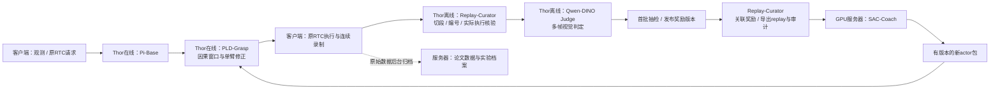

# PLD-Grasp 抓取修正专家：职责、接口与首批闭环方案（v2）

**用户确认的第一阶段目标：先取得真实抓取改善，再推进全局回报和更广的修正范围。** 专家统一命名为 **PLD-Grasp 抓取修正专家**，算法仍是PLD式残差SAC；现有`pld_sac_block_v2`协议名和版本ID保持。本版替代 v1 的客户端抓取编号与固定动作块调度要求。冻结 Pi0.5，由轻量残差 SAC 修正接近、对准、下降、闭爪、抬起并持住这一段；左右臂都可以进入，同一时刻只修正一只臂。首轮不改成全任务 RL，也不把历史离线 actor 漂移当成已学会修正。容器调整、运输与放置继续由Pi负责。这里的“专家”是模块名字，其中数据管家是确定性程序，视觉裁判是冻结模型组合。

**训练与评估分开：** 只有合格视觉证据的抓起持住1/明确空抓0进入SAC，中间transition为0；高度不代表成功，缺证据不伪装空抓。整轮`C/N`继续记录，只作评估，**本阶段不参与SAC更新**。验收与纯Pi比较左右臂空抓率、抓起持住率、抓取耗时，并检查容器调整误介入及整轮表现是否退步。

**当前现场状态（2026-10-12 15:31 CST）**：用户要求的`pld-rl`容器已接管`ws://192.168.250.1:8000`，旧`pi05-rtc-infer`停止保留；基础策略仍为原20w trained RTC。当前off/probe诊断，没有加载actor或施加修正；collect/eval/shadow明确拒绝，诊断trace不进入SAC。Qwen/DINO仍按独立批任务运行，未变成在线控制依赖。真实录像普通RTC＋probe各9例通过，当前MAXN/healthy；客户端跨IPC与真机采集待联调。[上线证据](../../thor/pld-rl-20261012/README.md)独立保留。

## 固定分工

| 名称 | 运行位置 | 输入 → 输出 | 明确边界 |
|---|---|---|---|
| **Pi-Base 基座专家** | Thor 在线 | 当前三相机、14D state、RTC 前缀 → 50×14 基础计划 | 冻结，不在现场训练 |
| **PLD-Grasp 抓取修正专家** | Thor 在线，与 Pi 同进程，连接独立状态 | 当前观测＋当前 Pi 预测 → 单臂7D有界修正与完整 trace | 进入/退出/双臂仲裁都在这里；不读取事后奖励 |
| **Replay-Curator 数据管家** | 优先 Thor 离线 CPU；同入口可在服务器运行 | 原 HIL 连续记录＋完整响应 → 抓取片段、正式编号、执行核验、奖励关联、replay | 无需训练；在线 window_id 与离线 attempt_id 分开 |
| **Qwen-DINO Judge 视觉裁判** | Thor 独立离线 GPU 任务 | 合格抓取片段的多帧与参考 → 持物/空手建议＋证据 | 不控制机械臂；现有判定还需抽检，不是已验收的自动奖励器 |
| **SAC-Coach 训练教练** | GPU 服务器 / Slurm | 审核发布的 replay → actor、双Q、温度、完整训练快照 | 不在 Thor 或工作站运行训练 |
| **客户端执行记录端** | 3588，由客户端 agent 改造 | 请求与返回 actions → 原 RTC 执行、限位、急停、连续 HIL 录制 | 不切抓取、不编号、不判奖、不选择活动臂 |



Qwen 没有迁往服务器；数据管家也不需要 GPU。先录制、后切段判分、再训练，属于分批在线 RL。首版不让 Qwen 与 Pi 同时争抢 GPU；后续若要边跑边判，先测 Pi 尾延迟和资源隔离。原始记录在后台保留并上传服务器，不能只保留压缩后的 replay。

## Thor 的介入逻辑

每次请求看当前夹爪状态和**本次 Pi 的未来计划**。当前张开≥0.65，Pi 在未来30 tick内预测闭合≤0.62且下降≥0.18，进入一个在线窗口。双臂同时满足时选预测闭合更早的，同刻固定左臂优先；被选臂持续到窗口结束，另一臂仍走 Pi。它是待实查覆盖率的启发式触发器，不是已通过的抓取检测器，也不要求客户端预判。当前仅凭张合预测不能保证识别“调整容器”；probe联调必须单独审核容器误介入，再决定是否可开启collect，不能把目标范围写成已经通过的语义隔离。

以实际观测到的闭爪为 FK 相对高度起点；抬升≥5cm、仍未重新张开，并在连续两次有效推理观测中满足时结束窗口。无额外等待1秒。重新张开、15秒超时、观测断档、epoch/模式/episode变化也结束或重置。**5cm只控制交还与证据资格，不等于抓到。** 不依赖桌面绝对标定；FK固定为YAM linear4310/grasp_site，单位米，左右臂分别在各自base坐标系计算相对升高。

每请求返回一个在线 `window_id` 和原生请求派生的 `decision_id`。它们只供追踪；最终 `attempt_id` 由离线测量轨迹产生，不要求在线窗口与抓取一一相等。一个窗口没对应到抓取、包含多个抓取或记录断裂时，都写审计，不强凑奖励。

Actor输入三路冻结ResNet18特征、14D状态、Pi计划、上个实际下发命令、活动臂、RTC延迟、窗口已过去时间和可行幅度。输出活动臂7D残差，含6关节与夹爪，因此能够修正抓取整段，而非只改开合。8 tick 是**修正包络长度**，不是要求客户端执行8帧后再推理；原RTC调度不变，实际执行区间由录制重建。前缀、非活动臂与包络外Pi动作保持原值。

物理半径仍是待审核提案：关节各±0.01rad、夹爪±0.02；实际上下限与每tick最大目标变化必须来自现有控制合同。模板留空，禁止拿合成合同部署。零均值初始化的确定性输出等于Pi，collect才采样小幅随机探索；第一包不是已经改善的专家。

## 数据与奖励

复用原录制的 epoch/tick/time、policy_reply.token、policy_selection.request/model_index、submitted_action、三路视频及有效位。客户端新增的是完整 `policy_reply.pld` 留存和模式身份，不新增逐抓取按键或固定动作块回执。已承诺前缀仍保留原请求来源，不能重标成最新请求。

数据管家按原物理轨迹规则切出闭爪候选，保留慢闭爪的张开起点；相机掉帧不拆断物理尝试。然后核查闭爪后的相对5cm抬升与新鲜图像，在释放前取多帧。视觉裁判沿用现有Qwen序列＋DINO参考，避免“桌上积木仍在腕部中心”的假成功；不用自动跟踪。缺证据不改成失败。

在原生请求时间线上核对完整Pi基础计划、修正计划和**实际提交动作**，按实际相邻观测区间生成transition。没有动作来源、HIL/额外限幅、取消/迟到导致不匹配、epoch断档、没有实际执行非零修正等情况分别记录；不能把请求发出就当作修正已执行。

唯一关联到同臂物理闭爪、且终态证据在本在线窗口内的尝试，才发布局部奖励：抬起持住为1、明确空手为0；中间transition为0，窗口最后已核验transition终止bootstrap。视觉证据tick与训练transition终点tick分别保存，不能靠人工审核时刻对齐。暂不把窗口交还之后Pi才完成的补救当成小专家成功。整轮C/N、分错/掉落、耗时另存用于整体A/B，本阶段不参与SAC更新，不重复铺到每帧。

旧14集保留为奖励流程和零修正行为对照；没有本版决策trace，不能冒充带修正经验。首批新数据先验证probe链路，再collect，自动候选经抽检后更新SAC。当前Qwen原始判断与旧批最终复核的一致率约59.36%，不能据此自动发全部奖励。

## 客户端模式与接口

只设置一个 `RL模式`：`off` 原Pi；`shadow` 计算但不执行修正；`probe` 记录同合同零修正基线；`collect` 执行随机有界修正并采集；`eval` 执行确定性均值用于A/B。客户端不根据某次是否抓取自动切模式。每整轮固定模式、checkpoint、actor、合同；新actor在整轮结束后加载。

能力按握手`pld.modes`启用，不能假定所有部署都支持五项。新`pld-rl`容器的首个部署阶段为`probe_diagnostics_only`：只支持`off/probe`，未加载actor，`collect/eval/shadow`明确拒绝。此时probe记录原Pi与Thor门控，用于联调，`replay_eligible=false`，不进入SAC；正式物理合同和actor包安装后再切换成完整五模式。协议schema仍为`pld_sac_block_v2`，两个阶段的contract/snapshot身份不同，客户端每轮重新读取握手。

沿用 `{type:"infer",obs,rtc}`，外层新增：

```json
{
  "pld": {
    "schema": "pld_sac_block_v2", "mode": "collect",
    "contract_sha256": "Thor握手值", "snapshot_sha256": "Thor握手值",
    "run_id": "实验批次", "episode_id": "原录制episode_id",
    "epoch": 8, "request_id": 123, "observation_id": 456,
    "previous_command": ["14个上一tick实际下发目标"]
  }
}
```

epoch/request_id/observation_id均复制原请求token，不建立第二套计数。`previous_command`是实际下发命令，不用测量state替代。`off`可以只发送`{"mode":"off"}`。输入图像、state、token须来自同一次原生观测快照。

返回顶层仍为 `actions:50×14`，客户端按原RTC消费。新增 `pld` 必须完整存到 `details.policy_reply.pld`，含基础计划、因果门控、身份、原观测state、模型特征、残差及修正计划；不应只取已认识的旧字段。取消/丢弃响应也保存，`discarded/error`按真实情况记录。原逐tick `policy_selection` 来源、14D `submitted_action` 和有效位保持。

严禁新增必填 `attempt_id`、`arm`、`elapsed_seconds`、手动抓取开始/结束或奖励按键。不要强制改为每8tick请求，也不要重写RTC前缀来源。完整字段与执行核验由同一数据处理入口消费。

客户端需回传现有14D上下限、每tick最大变化、夹爪映射及单位/来源；确认录制确实保留新增trace。握手不匹配或Thor未加载bundle时，不把collect静默显示成已启用；沿用原保护和明确报错/回退状态。

## 验收与第一轮

1. NumPy/传输测试：连接隔离、重置、双臂仲裁、前缀原值、实际执行关联、奖励只出现一次、取消/HIL/断档不伪造经验。
2. 服务器Slurm合成闭环：原生录制→切段/关联→replay→SAC→导出重载。合成结果单独归档，不作为训练效果。
3. Thor独立推理与CPU数据处理检查：不切换生产服务、不连接控制端。与v1一样只做前向，不做训练。
4. 客户端由用户审核本方案后改造。实际限位/base身份补齐，先2轮probe联调，再shadow看延迟，然后2轮collect试采，核验后扩至约10轮。
5. 首次更新的起步目标：至少60次有效带修正尝试、双臂各20次以上且有成功和失败。留最后一整轮作开发验证。不足按有效尝试数补采，不把旧14集充作新经验。
6. 沿用轻量SAC配方：双Q、target EMA、自动温度、真实秒数discount、critic:actor=2:1；先100步critic预热，再有限actor更新。没有兼容数据时不移植旧critic。本版不冒称完整PLD/CalQL复现。
7. 真机probe/eval交替比较左右臂抓起持住率、空抓率和抓取耗时，同时检查容器调整误介入、整轮C/N是否退步、掉落/分错和保护触发。训练loss不等于成功率。

服务端数据与实验归档沿用 `/home/wuyan/lyj/pld-grasp/`；Thor派生产物写新版本目录，保留原件、SHA、奖励审核版本、代码、配置、checkpoint、优化器、RNG和排除审计。旧v1资产只作历史，禁止混用schema。论文方法依据：[PLD](https://arxiv.org/html/2511.00091v1)、[SAC](https://spinningup.openai.com/en/latest/algorithms/sac.html)；当前是PLD式工程适配，不是完整论文复现。

## 数据管家操作入口

`Replay-Curator`只运行CPU数据处理，不导入Torch。Qwen/DINO继续使用原独立Thor视觉环境。本版先验证闭环，抓取门控、物理切段与持物判定是第一个任务适配器；SAC与执行来源/replay合同可复用，换任务仍需定义可核验的结果，不能宣称当前夹爪规则适用于所有任务。

```bash
# Thor离线：输入原录制episode路径，顺序固定并保存在manifest。
python scripts/pld_rl/curate_recording.py \
  --episodes /data/raw/session_a/episode_000001 /data/raw/session_a/episode_000002 \
  --validation-episodes /data/raw/session_a/episode_000002 \
  --export-evidence --output /data/releases/round01-candidates-v1

# 在原Qwen/DINO流程判读、抽检后发布reviewed.json。这里不自动发奖。
python scripts/pld_rl/curate_recording.py \
  --episodes /data/raw/session_a/episode_000001 /data/raw/session_a/episode_000002 \
  --validation-episodes /data/raw/session_a/episode_000002 \
  --rewards /data/releases/round01-reviewed-v1.json \
  --output /data/releases/round01-reward-release-v1

# Thor离线或服务器：核对不可变发布SHA后生成训练replay。
python scripts/pld_rl/prepare_blocks.py \
  --curator /data/releases/round01-reward-release-v1 \
  --bundles /data/bundles/round01-bootstrap \
  --output /data/releases/round01-replay-v1
```

这些是接口示例路径，不是当前实际采集包或立即开训命令。输出目录必须新建，不能覆盖。`reviewed.json`每项字段为`candidate_id/candidate_sha256/status(held|empty)/approved=true/reviewer/evidence_rows`，其中evidence_rows选自同一候选内释放前、≥5cm且新鲜的取样帧行。审核SHA绑定原始H5和视频SHA、候选内容；不能修改数据后复用旧批准。新响应输入按原生`observation_id`关联原记录，不能假设图像行号、控制tick、请求收到时刻三者相同。

客户端转交文本单独放在[client-request.md](client-request.md)，供用户审核和转发；本任务未自动发送给客户端agent。

## 已完成验收与实际剩余条件

代码固定 `e2b60f1`；[验证汇总](validation.json)绑定逐项报告SHA。

- 本地34项轻量检查通过：8项数组合同、5项原生录制/门控/关联、21项WebSocket协议；没有本地训练或神经网络前向。
- Slurm **2317**，1×4090，退出0：8次合成尝试/24条数组transition校验；另将原生H5＋三MP4走完候选导出、审核版本绑定、实际来源核验、replay编译，得到1次合成尝试/3个可变长度transition；再进行40次critic、18次actor更新及导出重载。作业7秒，只是数值测试，不是专家收敛。见[服务器报告](server-validation.json)。
- Thor用独立前向进程验证6例，自动选择左右臂、零均值等于Pi、float64前缀与另一臂不变、有界非零采样通过。新增后处理P50 **19.84ms**，最大 **40.95ms**，少量样本且不含Pi/IPC，不是生产P95。见[Thor前向](thor-inference.json)。
- Thor现有Qwen视觉镜像中，CPU数据管家完整走过H5＋三视频→候选→合成审核→奖励关联→replay，3条transition且只出现1次末端奖励。该验证未运行Qwen/DINO、没有训练，标签由合成测试oracle提供。见[Thor数据管家](thor-curator.json)。
- NumPy FK与MuJoCo同一固定MJCF的1000组关节输入对照，最大坐标差约`6.66e-16m`；这证明软件运动学一致，不证明现场桌面标定/物理限位。依赖wheel本地下载后传服务器，几何校验在隔离路径运行，原训练环境未安装MuJoCo。见[FK报告](fk-validation.json)。

服务器所有原始合成文件、三视频、图像、输入/审核SHA、配置、日志、优化器/checkpoint和bundle保存在 `runs/sac-block-validation-20261012-v2-r2/`；Thor独立资产在 `thor/pi/cache/pld-sac-validation-20261012-v2-r2/`。前一版r1保留，未覆盖。合成测试不进入用户真实训练看板或论文成功率统计。

**仍需客户端实际联调、真实限位和门控覆盖验收。基础20w身份已核对，生产服务已切到pld-rl诊断入口；没有操作3588，没有启用真机修正。** 下一步先probe，核对输入观测来源、前缀、逐tick提交值和采集完整性，再进入collect；本轮没有开始真实数据SAC训练。
