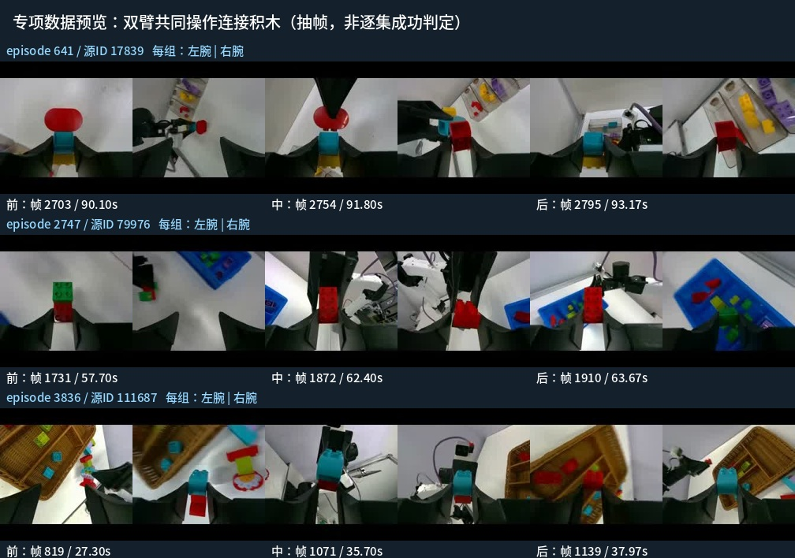

# 乐高拆开专项与分拣回放数据准备

2026-10-14最终范围：现用50h之外选100集，原50h之内选100集，保留完整episode；数据发布回执保留准备时的 **DATA_AUDITED_RECIPE_PENDING**；用户随后确认v1并启动2344，之后明确改为[10000步v2](replacement-10k/README.md)：2344取消于日志481步，独立新作业2345已核验真实更新至31步（18:59+08快照）。原始数据、既有50h选择、验证集、下载任务和训练均未改动。

| 池 | 集数 | 帧数@30fps | 小时 | 完整H50窗口 | 原生帧采样期望 |
|---|---:|---:|---:|---:|---:|
| 双臂横置专项 | 100 | 278,516 | 2.578852 | 273,616 | 50% |
| 旧分拣回放 | 100 | 278,516 | 2.578852 | 273,616 | 50% |
| 总计 | 200 | 557,032 | 5.157704 | 547,232 | 100% |

## 交付与来源

- [200集原生episode清单](bimanual100-replay100/episodes.json)、[专项100集](bimanual100-replay100/specialist-episodes.json)、[回放100集](bimanual100-replay100/replay-episodes.json)。ID属于本地发布的LeRobot train，不是上游source ID。
- [逐集来源与事件](bimanual100-replay100/dataset.json)、[发布身份](bimanual100-replay100/release.json)、[审核汇总](bimanual100-replay100/audit-summary.json)、[逐集审核](bimanual100-replay100/audit.jsonl)、[抽帧审阅范围](bimanual100-replay100/visual-review.json)。
- [全量双臂扫描摘要](bimanual100-replay100/scan-summary.json)。最初单臂方案的30集试选留在`pilot-30/`，不属于最终200集合同。
- [原始配方草案](recipe-draft.md)保持原字节；[本轮明确确认](approval.json)已绑定其SHA，[正式配置](../../../../configs/native/pi05-lego-separation-r1.json)已按原样生成。

服务器子集目录：`/home/wuyan/lyj/YAM/data-reviews/lego-separation-20261014/dataset-bimanual100-replay100-v1/`。实际数值/视频仍只读引用`/home/wuyan/lyj/YAM/YAM_data/processed/lego_lerobot_v1_20260907/train`，不是复制出另一套LeRobot数据。现有原生trainer支持按`episodes.json`加载这个版本的完整episode。

服务器完整逐集姿态结果在`scan-bimanual-v2/episodes.jsonl`，视频预览在`review-bimanual-top140-v2/`，全部以同一报告根目录为父目录。源码快照在`source-v2/scripts/`；初次运行代码与失败/取消现场均保留。大预览本地在被Git忽略的`artifacts/lego-separation-20261014/`，小预览如下。

## 7000步现场反馈与只读诊断（2026-10-15）

用户报告测试专项run第7000步，约10次只有1次主动尝试拆开，整体效果差。这是约数的动作触发反馈，不是已完成受控评估的拆开成功率；主动尝试后的成功情况和其余尝试的行为仍待明确。本次只读核查，没有修改数据、训练配置或部署。

按服务器原始`scan-bimanual-v2/episodes.jsonl`取最终专项100集的**全部事件**（不是发布manifest中每集仅保留的前三个事件），逐集裁到合法帧范围后合并重叠区间：10Hz扫描共698个双臂横置候选事件，横置区间并集50,898帧，折合28.277分钟，占专项278,516帧的18.275%；专项池贡献的已检测横置帧占全部557,032帧的9.137%。episode时长中位数82.767秒，事件时长中位数2.2秒。该值是姿态扫描估计，不是真实成功拆开动作占比；旧回放池未做此扫描，也可能贡献相关动作。按H50计算，动作块与这些区间有交集的起点在专项池约29.094%，在全部数据中由专项池贡献约14.547%；这也不是目标动作loss权重，RTC前缀mask和动作块内其他时刻仍影响监督。

原生配置复核为parent240000、batch32、总目标10000、warmup200、peak3e-6/floor3e-7、cosine10000、200集。7000步共224,000个帧起点，专项期望112,000，约0.402个专项帧起点遍历量，不把H50乘成50倍独立样本。metrics日志每10步记录：1–1000区间mean loss0.014200，5001–7000为0.007888；总体优化下降不能证明拆开触发能力改善，也不能单凭遍历量认定必须加步数。7000检查点提交标记、params与train_state存在。部署转换/协议证据归[7000部署报告](../../thor/rtc-separation-r1-7000-20261015/README.md)，该证据不代替真机任务验收。

优先假设是完整episode内目标行为稀释，以及姿态候选未核验成功语义、拆开前触发状态覆盖不足；尚不能把失败因果确定为旧回放50%或学习率/步数。本轮准备验证了文件、姿态存在和loader，没有在训练前量化成功拆开片段占比，属于数据有效性审核不足。后续宜先核验连续成功片段及其识别/接近/双臂抓持上下文，检查实际失败状态并考虑人工接管纠正，再比较有效事件采样与旧回放比例。当前是离线专项示范加回放，尚无本轮策略失败状态上的新专家纠正数据；不冒充完整DAgger。任何下一轮训练配方须另行展示确认，不由本诊断生成配置或启动作业。

## 筛选定义与审核范围

先从4,458个train episode中减去固定50h的2,337集，得到2,121集、4,973,496帧、46.050889h；val未进入任何池。使用官方YAM/linear_4310 `grasp_site`名义FK，长轴为site +Z，底座+Z暂作竖直方向，各臂独立计算，不推断未标定的双臂相对距离。

主条件：两臂长轴同时距离水平≤20°，连续至少0.3秒；至少一臂该段与有效单臂抬升/转横事件重叠。单臂事件要求此前4秒内存在朝下≤45°的姿态，抓取点名义抬升≥0.025m、倾角变化≥25°。腕部高度另记，避免把旋转导致的指尖位移当成真实平移。两夹爪闭合比例只参与优先排序，不作为接触力或抓取成功标签。

10Hz全量扫描得到1,109个候选集、3,711个事件；选排序前100集，均在后续30fps完整复核中保留双臂事件。已浏览100集的双腕前/中/后概览，原三视角完整联系表保留；可见多色连接件、两臂共同操作和部分连接件减少。该审阅不是连续视频逐次成功判定，没有测出筛选召回率或逐集成功率，同色件/遮挡与普通搬运仍可能混入。`separation_success`保持未知，原任务prompt不改为“拆开”。

回放从固定50h按seed42，将episode ID排序后十等分、每段10集，并在段内交换成员，使帧数与专项池相同。这是ID范围分层，不冒充已知采集session分层；旧池也可能包含有益的拆开示范。两池无重复，专项与旧50h无交集，回放全部属于旧50h。

全部200集均通过14D有限值、连续帧号、30fps数值时间戳、三路224×224视频逐帧解码/PTS连续性及逐文件SHA审核：600个episode视频范围、1,671,096个解码帧。复用部分已完成记录前重新核对数值和视频SHA。源发布者单位合同、名义模型与行内对齐的审核不代替独立raw单位/真实捕获时序/桌面标定。

完整H50窗口数仅作预算统计。当前原生loader仍按全部帧起点抽样，沿用完整episode尾部动作padding；没有把窗口统计包装成已实现的完整窗口过滤器。训练norm建议继承固定240000 checkpoint的50h资产，未重算、未把旧norm来源冒充200集。

## 运行与下一步

数据Slurm：2337单臂初筛，2338/2339初步预览，2340双臂复扫，2341双臂预览，2342初次审核（为并行提速主动取消、保留已过记录），2343复用已过SHA并完成全部审核。没有申请GPU，也没有进入训练循环。8项规则与回放选择测试通过，修改范围静态检查通过。

100＋100、按帧期望1:1适合作为首轮专项/回放候选，但100集旧数据只覆盖原50h的一部分，不保证保留能力。先以固定240000为对照，分别比较普通分拣与卡住拆开；如普通分拣回退，后续再讨论扩大旧池，不能在本轮训练中途静默改数据或比例。原v1启动回执保留为历史。当前改用[10000步v2](replacement-10k/README.md)独立run与Slurm2345，监控使用[当前交接](monitor-handoff.txt)。51个原生FP32参数数组全部有限，800个真实loader样本通过，原数据SHA复核及原生resolved config通过。12项本任务轻量回归通过。本轮不自动切换推理服务。
