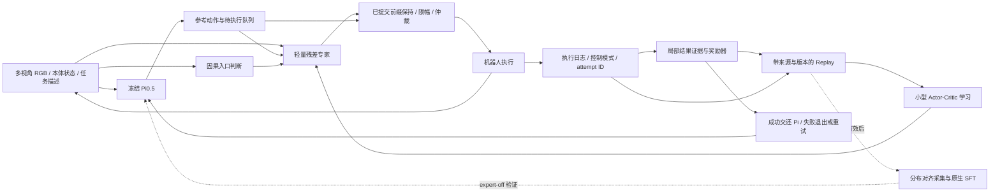
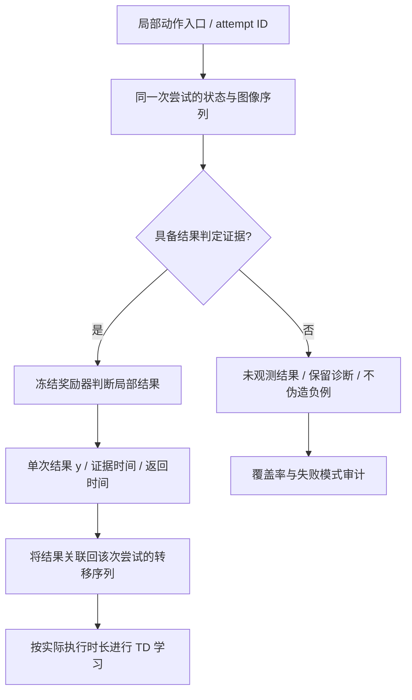

# PLD 式 VLA 局部动作修正：研究设计工作稿

2026-10-12 · 未进行本方案的 RL 实验。本文接续用户已选方向，保存可以逐步验证的研究设计；不锁定创新，也不是训练配置。

## 1. 当前先做什么

保留已选主线：Pi0.5 负责完整任务，小专家修正失败集中出现的局部动作，首例为对齐、下降、闭合、抬升及持住，随后交还 Pi 运输和放置。先验证外挂专家是否有效，再验证哪些设计可复用，最后评估专家经验能否沉淀到 VLA。

这条路线结合了 PLD 的专家—采集—蒸馏逻辑与 PARTS 的局部实践组织；不是声称严格复现某篇原配方。SAC＋Cal-QL 价值初始化属于当前首选研究基线，TD3+BC 是贴近 PARTS 的必要对照。[PLD](https://arxiv.org/html/2511.00091v1)、[PARTS](https://arxiv.org/html/2609.21788v2)、[Cal-QL](https://arxiv.org/abs/2303.05479v4)

## 2. 拟议架构

以下图表示研究模块与数据关系，不代表项目中已经接通这些服务。

奖励器、critic、入口判断各有职责。奖励器判断已经发生的结果；critic 预测当前决策的未来价值；入口判断决定当前是否可介入。不能把事后才知道的成功标签输入当时的入口或 actor。

## 3. 决策、执行与状态

用 `t` 表示小专家决策时刻，`H` 表示 Pi 输出 horizon，`k_t` 表示该决策实际执行的控制步数。输入记为

\[
z_t=(f(o_{t-h:t},g),p_t,A^b_t,q_t,m_t,b_t),
\]

其中 `f` 为图像/短历史编码，`p` 为本体状态，`A^b` 为参考动作，`q` 为必要队列与时间信息，`m` 为控制模式/活动臂，`b` 为本次尝试边界信息。这里的 `z` 是部分可观测状态的近似，不宣称天然满足 Markov 性。

采用有界修正：

\[
A_t^{exec}=P_{z_t}\big(A^b_t+M_t\odot B\odot\tanh U_t\big),
\qquad U_t\sim\pi_\delta(\cdot|z_t).
\]

`M` 决定可改的动作维度及时间位置；`B` 是物理幅度尺度；`P` 表示已提交前缀保持、限幅与执行仲裁。符号描述的是学习接口，不规定本轮幅度、频率或 chunk 长度。不能把 YAM 14D 关节合同直接当成原文 7D 末端位姿动作。

首个场景覆盖左右臂。起步可共享网络并加入活动臂条件，每次只修正被选中的一臂、另一臂跟随 Pi；这是双臂覆盖的实现候选，不能称同时协同修正已解决。若双臂干预重叠，应独立记录仲裁及其对其他臂成功率的影响。

原始 actor 输出、投影后实际下发命令、实测状态必须分别保存。critic 评价与转移相对应的命令；不能把未执行 suffix 当作已发生动作。这个要求是正确性底线，不自动算创新。实时执行相关先例包括 [ResiP](https://arxiv.org/abs/2407.16677) 与 [Real-Time EXPO-FT](https://arxiv.org/html/2609.18207v1)。

## 4. 奖励落在一次局部尝试，学习仍使用序列转移

### 4.1 先定义结果，不预设该怎么修

第一基线使用局部终止结果：确证完成给 `1`，确证未完成给 `0`。在抓取中指“抓起并保持住”；不奖励下降更深、夹得更紧或抬得更高本身，避免把解法写死。关节/接触限制与任务奖励分开。

仅有 held 奖励可能学到不好放置的抓姿，因此完整任务必须另测。未来可以比较下游成功塑形，但应明确归属 [Foresight Residual RL](https://arxiv.org/html/2607.16506v1)；不会把它混进第一基线后再称局部 reward 有效。

### 4.2 帧提供证据，不意味着每一帧都重复给 1

多个持物帧是对同一结果的证据；默认只在该尝试终止处发一次结果奖励。靠 TD 把结果向前传播，学习哪些对齐、下降与闭合命令更有利。不把整段每一帧都标 `r=1`，否则长时间停留可能累计更多奖励。

本批 `5 cm` 是核验可观察性的启发式，且只是记录 FK 相对闭爪高度；它不是通用成功定义，也不是以后必须执行的固定轨迹。插入、释放和关合需要各自可观察的完成条件。统一框架首先统一输入、结果、证据和学习接口；不保证消除所有任务语义。

缺少证据不能自动等于失败。产品上可继续追求明确分类，但训练应区分“结果已证实为失败”和“结果没有被看到”。未评分的实际尝试仍计入完整任务评估，不能通过排除难例提高成功率。

### 4.3 延迟与归属的区别

记录三类时刻：物理事件所在区间、图像采集时刻、奖励计算返回时刻。计算晚几秒只意味着训练反馈晚到，不应把 reward 贴给返回时正在进行的下一次抓取。

反之，证据出现在交还 Pi 之后，也可能仍然是前面抓姿的合法结果。不能要求“结果证据必须落在残差控制窗口内”，更不能用时间交集推断因果。延迟奖励与历史价值已有专门先例：[Han 等](https://proceedings.mlr.press/v162/han22e.html)、[Mondal 与 Aggarwal](https://arxiv.org/abs/2305.02527v2)。

## 5. 基线学习目标及其边界

先用实际执行的短块定义普通 off-policy 备份：

\[
Y_t=\sum_{j=0}^{k_t-1}\gamma^j r_{t+j}
+\gamma^{k_t}(1-d_t)\left[
\min_i \bar Q_i(z_{t+k_t},A'^{exec})
-\alpha\log\pi_\delta(U'|z_{t+k_t})\right].
\]

这里 `Aexec` 是本次实际消费的命令块；若时长可变，应把长度/有效位置纳入表示。熵项定义在残差策略采样变量 `U` 上，不冒充非可逆限幅后的执行命令密度。该式是基线示意，正式实现要检查策略参数化、tanh 变换和 termination 语义。

critic 用 `(Q-Y)^2` 学习，actor 在约束内提高 Q，并保留选定的熵或参考动作约束。chunk TD、实际时长折扣本来就是已发表方法和 SMDP 正确性要求；不当作新推导。[Q-chunking](https://arxiv.org/html/2507.07969v2)

本地尝试失败结束，可将它视为局部训练 episode 的真终止；物理断流、缺证据及日志结束则须区别处理。不能跨 reset 拼转移；也不能对一个尚未观察结果的后缀擅自补 `r=0, done=1`。timeout 若预先定义成任务失败，与设备中断不是同一件事。

Cal-QL 是候选价值初始化方式，不是“数据少也能推断所有修正”的保证。原文算法应复用可信实现，不从某篇转述中抄写可能缺项的损失。首轮是否采用、初始化数据组成与 actor 更新范围，属于以后单独确认的训练配方。

## 6. 14 集怎么服务研究

已有数据按 [来源记录](../sources/user_materials.md) 管理。当前不改标签、不拆分文件、不生成 replay。

| 用途 | 现在能支持什么 | 尚缺什么 |
|---|---|---|
| reward 开发 | 正负候选、边界错误、背景误报与空手参考 | 新鲜独立真值、冻结规则后的测试 |
| critic 初始化研究 | 原 Pi 行为附近的结果/回报诊断 | 非零修正覆盖、真实 base chunk/执行链可追溯性 |
| residual actor 学习 | 初始置零可保持底座行为 | 有界自主探索经验；不能凭零残差数据声称学会纠正 |
| 完整任务评估 | 历史分拣记录可作背景 | 独立随机化的 Pi 与专家对照 |
| 通用性 | 可设计统一接口 | 异类任务、留出场景与适配成本 |

用户曾保留 E01 做项目验证；本研究不改变这个操作安排。但 E01 已参与感知开发，不能再叫未见 reward test。14 集整体先视为开发/历史审计集，除非以后能证明某部分始终未影响设计。

## 7. 候选研究扩展，不作为当前承诺

如果正确 attempt ID、图像新鲜度和执行命令记录已经解决全部问题，则先接受工程基线，不另造算法。

如果仍存在真实的事件归属歧义，可以研究保留多个可能归属的学习目标，而非硬贴到最近 chunk。令 `h` 表示满足时序和实体约束的候选归属，计算各自 `Y(h)`；先用 `[min_h Y(h), max_h Y(h)]` 量化敏感性，再讨论是否需要有校准依据的边缘化或保守估计。

这个区间不是统计置信区间，也不保证包含真实价值：候选集合漏掉真归属时，区间本身也会错。它只提供研究方向和诊断量。若做算法，需要与已有延迟奖励、历史 critic、保守 RL 及正确实时基线比较，并说明假设与证明边界。

## 8. 从专家到长期能力

只有当外挂专家在独立任务评估中变好，才进入 PLD 式采集/蒸馏：比较纯专家轨迹、底座先运行再专家恢复、相同预算的成功 Pi 数据。训练后关闭专家测试，同时检查原任务与留出任务保留能力。[PLD §3.2](https://arxiv.org/html/2511.00091v1)

“专家仍在线时系统更好”和“VLA 离开专家也变好”是不同结果。RECAP 可以作为未来另一条吸收好坏经验的路线，不需要现在与外挂专家路线二选一。

具体对照和停止条件见 [实验矩阵](../experiment-matrix.md)。
